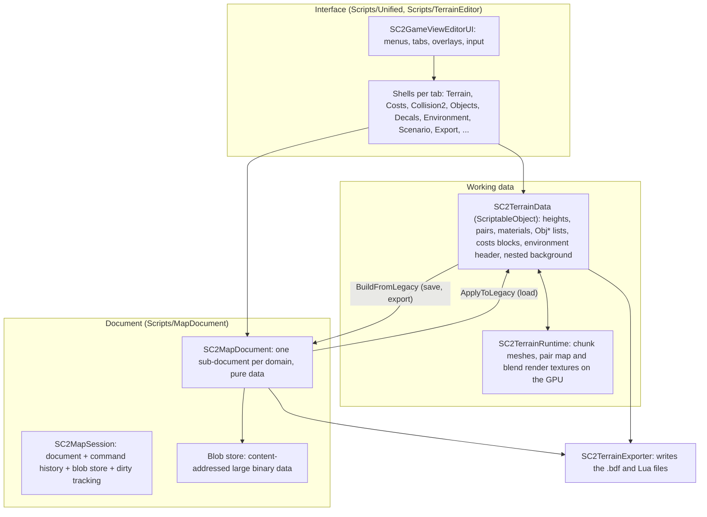

# Architecture overview

Status: first draft from reading the code at commit `17863e4`; not yet reviewed by a second reader. Read this before any system document:
they all assume it.

## 1. What the editor is

A Unity application whose interface is drawn entirely with IMGUI inside one game view, the same way in the Unity editor and in a standalone
Windows player (the user's real build). It edits a map for Supreme Commander 2 and writes the game's own binary formats (`terrain`, `hfield`,
`costs`, `collision2`, `info`, `mapobjs`, `decals` `.bdf` files and the `_scenario`, `_save`, `_script` Lua files) into a folder that is packed
as a `.scd` map.

## 2. The three layers

1. **Interface.** `SC2GameViewEditorUI` is the host: the menu bar, the main tabs (`SC2EditorTabs`), the overlays (hotkeys, theme, texture browser,
   import, confirm dialogs), input and the camera. Each tab has a **shell** class that draws its panel and handles its viewport input:
   `SC2TerrainShell`, `SC2CostsShell`, `SC2Collision2Shell`, `SC2ObjectsShell`, `SC2DecalsShell`, `SC2EnvironmentShell`, `SC2ScenarioShell`,
   `SC2ExportShell`, `SC2ReferenceUnitsShell`. A shell is a plain class (or `ScriptableObject`), never an `EditorWindow`, so it runs in a build.
2. **Working data.** `SC2TerrainData` (`Scripts/Core`) is the live data the shells edit directly: the height grid, the material pairs and the
   triangle-to-pair assignment, the object lists (`ObjProps`, `ObjMarkers`, `ObjUnits`, `ObjArmies`, `ObjGraphs`, `ObjZones`, `ObjChains`), the costs
   blocks, the 508-byte environment header and its texture paths, and a nested `BackgroundTerrainData` (a second `SC2TerrainData`).
   `SC2TerrainRuntime` turns heights and pair data into chunk meshes and keeps the pair map and the blend mask in render textures.
3. **Document.** `SC2MapDocument` (`Scripts/MapDocument`) is the pure-data model of a map, split into domain sub-documents (`Terrain`, `Hfield`,
   `Costs`, `Collision2`, `Environment`, `Objects`, `Scenario`, `Decals`, plus identity, source and archive). The `SC2MapSession` that owns it
   adds the command history, the blob store and the dirty tracking. The document is what is saved and what a validator reads.

The two data layers coexist on purpose and are being merged domain by domain (the comments in `SC2MapDocument` say which domains have commands
and which are still read-only snapshots). The rule today: **the shells edit the live data; the document is built from it when saving, and the
live data is rebuilt from the document when loading.** Some domains also edit the document directly through commands (renames, positions,
environment texture paths, decals); their shells then copy the result back into the live data.

## 3. How an edit travels

1. A user event reaches the host, which passes it to the shell of the active tab.
2. The shell changes the live data (a brush stroke, a field, a list) and, for a domain that has commands, executes an `ISC2DocumentCommand` on
   `Session.History`; it also records an undo step (section 5) and marks the session dirty (`SC2MapSession.MarkDirty`).
3. The runtime redraws from the live data; a preview that is derived (baked lighting, the background, the water) is refreshed when its inputs change.
4. Saving (`SaveState`): the GPU state is read back into the live data (`FlushActiveBlendGroup`, pair map sync), then
   `SC2RuntimeTerrainPersistence.Save` builds the document with the `*LegacyBridge.BuildFromLegacy` bridges and writes it, with its blobs and
   a backup snapshot, into the map's folder.
5. Loading is the reverse: `TryLoad` reads the manifest, `SC2MapDocumentToLegacyBridge.ApplyToLegacy` rebuilds a live `SC2TerrainData`.
6. Export (`SC2TerrainExporter.ExportCorrect`) does not read a saved file: it builds the files from the live data and the session's document, on a
   worker thread behind the busy overlay.

## 4. The editor and a player build

The same classes run in the Unity editor and in a player, and a good part takes a different path in each:
- `UnityEditorRuntimeShim` stands in for editor-only APIs in a player (`EditorUtility.DisplayDialog` always answers yes, `Undo` does nothing, and so on).
- Saving, loading and backups exist only in a player (`SC2RuntimeTerrainPersistence`, compiled for `!UNITY_EDITOR`); in the editor, saving goes through
  the asset database.
- Dialogs, dropdowns, file pickers and the object picker have runtime replacements (`SC2RuntimeConfirm`, `SC2RuntimeDropdown`, `SC2RuntimeFileDialog`,
  `SC2RuntimeObjectPicker`).
- The interface is drawn with plain `GUI`/`GUILayout`, never `EditorGUILayout`, so it looks and behaves the same in both.

See [Editing](Process/Editing.md), section 3.

## 5. Undo

There is no single undo system. Three mechanisms exist, and one coordinator joins them per shell:
- **Snapshot stacks** that copy the whole state of a domain before a change: `SC2TerrainUndoStack` (terrain, materials, pairs), the object lists of
  `SC2ObjectsShell` (JSON snapshots), the Costs stack of `SC2CostsShell`.
- **Command history**: `SC2CommandHistory` holds `ISC2DocumentCommand` steps (`Do`/`Undo` on the document).
- **Opaque channels**, for example the blend mask checkpoints of a paint stroke.
- `SC2ShellUndoCoordinator` keeps, for one shell, a marker stack that remembers which mechanism owns each step and in what order, so one Undo
  button walks back through all of them chronologically. Every stack keeps `SC2ShellUndoCoordinator.MaxSteps` (100) steps.
- The global Ctrl+Z (`SC2GameViewEditorUI.UndoTerrainEdit`) asks every shell for the time of its latest step and runs the undo of the shell whose
  step is the newest.

A restored snapshot replaces objects; anything that holds a reference by identity breaks after an undo and has to be re-established (see the
shared material list, `SC2SharedMaterials.Sync`).

## 6. Projects, assemblies and tests

- Assemblies: `SC2.Core` (`Scripts/Core`), `BdfIO.Core` and `BdfIO.Formats` (`Runtime/BdfIO`), `SC2.MapEditor.SmartExport`, `SC2.GameAssets`,
  `SC2.GameAssets.Unity`, `SC2.ThirdParty.KopiLua`, `SC2.Tests.EditMode`. Everything else is in the default assembly.
- The default assembly cannot be referenced by an EditMode test; a rule that needs a unit test belongs in `Scripts/Core`.
- Which assembly references which, the graphics settings that the player needs, and the folders that are ignored by git: [Project and build settings](Systems/ProjectAndBuildSettings.md). The pure rules and their tests: [Core rules](Systems/CoreRules.md).
- Tests: [Testing](Process/Testing.md).

## 7. Where each system is described

See [the index](README.md). Before a first change read [Orientation](Orientation/README.md): the live routes against the legacy ones, the big files and the sources of truth. How the systems depend on each other, with every event, counter and order of operations: [Interactions](Interactions/README.md). The game's file layouts are in [Formats](Formats/README.md). The systems are numbered as in `DocumentationPlan.md`, plus the ones added while writing (Collision2 and the catalogues listed in the index).
